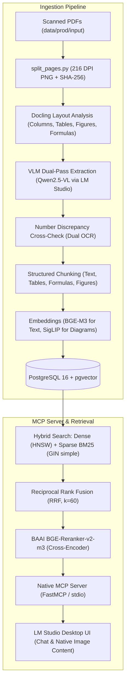
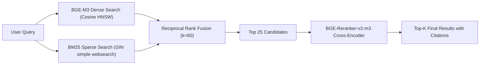
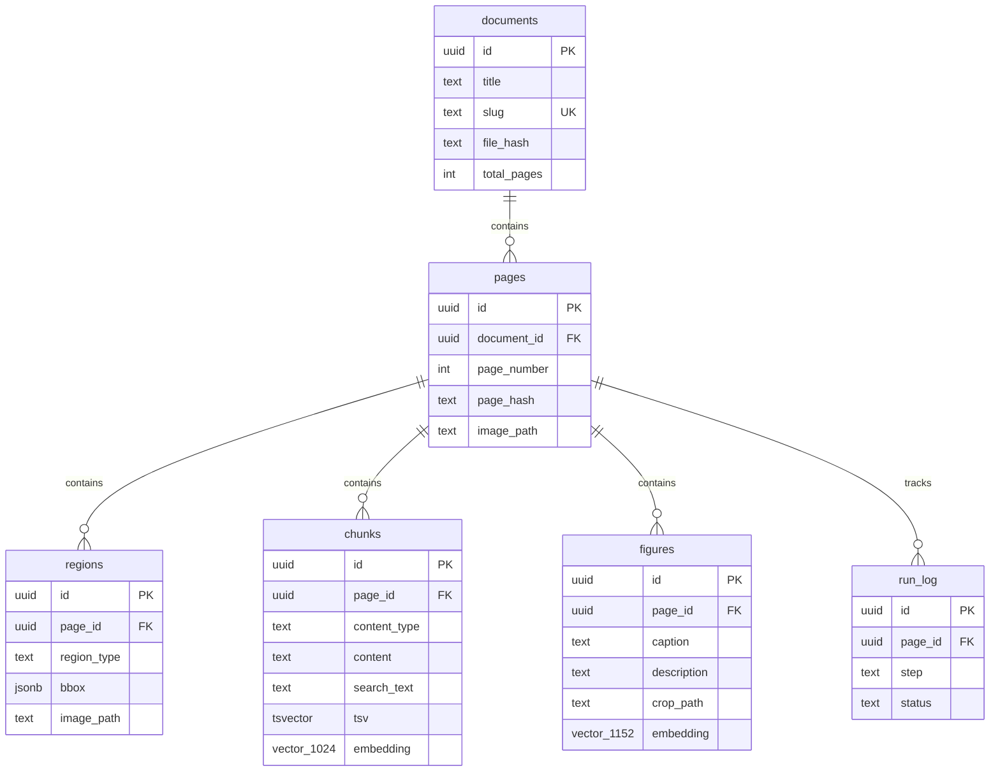

# RAG over Scanned Technical Books: Production & Architecture Manual

Comprehensive architectural documentation and operational manual for **RAG over Scanned Books** — an enterprise-grade, air-gapped Retrieval-Augmented Generation (RAG) system with native Model Context Protocol (MCP) support for [LM Studio](https://lmstudio.ai).

---

## Table of Contents
1. [System Architecture & Pipeline](#1-system-architecture--pipeline)
2. [Complete Codebase File Inventory](#2-complete-codebase-file-inventory)
   - [Workspace Root](#workspace-root)
   - [Core Package (`packages/core`)](#core-package-packagescore)
   - [Ingestion Package (`packages/ingestion`)](#ingestion-package-packagesingestion)
   - [MCP Server Package (`packages/mcp_server`)](#mcp-server-package-packagesmcp_server)
   - [Offline Bundle (`offline_bundle/`)](#offline-bundle-offline_bundle)
   - [Docker Infrastructure (`docker/`)](#docker-infrastructure-docker)
   - [Lifecycle & Utility Scripts (`scripts/`)](#lifecycle--utility-scripts-scripts)
   - [Tests & Development Tools (`tests/`, `tools/`)](#tests--development-tools-tests-tools)
3. [End-to-End Production Deployment Guide (Air-Gapped)](#3-end-to-end-production-deployment-guide-air-gapped)
   - [Prerequisites](#prerequisites)
   - [Step 1: Unpack and Verify the Offline Bundle](#step-1-unpack-and-verify-the-offline-bundle)
   - [Step 2: Start PostgreSQL 16 + pgvector](#step-2-start-postgresql-16--pgvector)
   - [Step 3: Run Zero-Internet Python Installation](#step-3-run-zero-internet-python-installation)
   - [Step 4: Configure Production Environment (`.env`)](#step-4-configure-production-environment-env)
   - [Step 5: Apply Database Migrations](#step-5-apply-database-migrations)
   - [Step 6: Ingest Scanned Technical Books](#step-6-ingest-scanned-technical-books)
   - [Step 7: Configure LM Studio MCP Client](#step-7-configure-lm-studio-mcp-client)
   - [Step 8: Querying in LM Studio](#step-8-querying-in-lm-studio)
4. [Retrieval & Ranking Engine](#4-retrieval--ranking-engine)
5. [Database Schema & Indexes](#5-database-schema--indexes)
6. [Data Lifecycle & Phase 6 Dev Purge](#6-data-lifecycle--phase-6-dev-purge)
7. [Troubleshooting & FAQ](#7-troubleshooting--faq)

---

## 1. System Architecture & Pipeline



### Key Architectural Tenets
1. **Air-Gapped & Self-Contained:** Zero internet calls during production runtime. All models (`offline_bundle/models/`) and Python libraries (`offline_bundle/wheelhouse/`) reside on local disk.
2. **Dual-Environment Portability:**
   - **`dev` mode:** Offloads heavy PyTorch models to an external GPU server (e.g., Google Colab over Cloudflare tunnel) to protect host RAM.
   - **`prod` mode:** Loads local weights directly with `HF_HUB_OFFLINE=1` and `TRANSFORMERS_OFFLINE=1`.
3. **Structured Ingestion vs Plain OCR:** Tables are transformed into exact Markdown/HTML grids; formulas into LaTeX equations; figures into technical component breakdowns. Dual-OCR cross-validation prevents numeric transcription errors.
4. **Native Image Return:** MCP server returns both citation text and native Base64 `ImageContent`, allowing LM Studio chat to render schematics directly in tool cards, even when the user runs a non-vision model.

---

## 2. Complete Codebase File Inventory

### Workspace Root

| File | Purpose |
|---|---|
| `pyproject.toml` | UV Workspace root definition declaring workspace members `packages/*` and requiring Python 3.11. |
| `uv.lock` | Deterministic, multi-platform dependency lockfile specifying 145 pinned third-party packages and exact hash stamps. |
| `.env.example` | Master configuration template documenting database credentials, `DATA_ROOT`, device settings, and model paths. |
| `.env` | Active runtime environment file (ignored by git, customized per deployment). |
| `run_mcp.py` | Standalone entry point for LM Studio. Automatically forces current working directory to project root and prepends package `src` directories to `sys.path`. |
| `mcp_config.json` | Auto-generated configuration snippet ready to paste into LM Studio's `mcp.json`. |
| `README.md` | Master architectural, deployment, and operational manual. |

---

### Core Package (`packages/core`)
*Location: `packages/core/src/ragcore/`*

The foundational library shared by both the ingestion pipeline and the MCP server.

| File | Purpose |
|---|---|
| `config.py` | Pydantic Settings class (`Settings`) loading configurations from `.env` (database hosts, ports, passwords, model paths, execution mode). |
| `schema.py` | Core Pydantic domain models: `DocumentRecord`, `PageRecord`, `RegionRecord`, `ChunkRecord`, `FigureRecord`, and `RunLogRecord`. |
| `paths.py` | Centralized path resolver providing absolute paths for `DATA_ROOT`, input PDFs, extracted page images, regions, and offline models. |
| `logging.py` | Structured, content-safe logger. Ensures IDs, statuses, and timings are logged without exposing sensitive proprietary book content. |
| `embeddings.py` | Dual-mode embedding generator. Computes 1024-dim BGE-M3 text embeddings and 1152-dim SigLIP visual embeddings. Sets `HF_HUB_OFFLINE=1` in production. |
| `reranker.py` | Cross-encoder reranker wrapping `BAAI/bge-reranker-v2-m3`. Re-scores candidate search results. Features fallback ranking if endpoints are offline. |
| `retriever.py` | `HybridRetriever` combining dense vector search, sparse full-text search (`tsvector` with `simple` configuration), Reciprocal Rank Fusion ($k=60$), and Cross-Encoder reranking. |
| `db/connection.py` | PostgreSQL connection pool (`psycopg_pool.ConnectionPool`) with automatic failover and a 5.0-second timeout to prevent deadlocks when Docker is stopped. |
| `db/migrate.py` | Migration orchestrator executing numbered SQL scripts against the database and registering version numbers in the `meta` table. |
| `db/repository.py` | High-level data access layer (DAO) for upserting documents, pages, regions, chunks, figures, and tracking ingestion progress in `run_log`. |
| `db/migrations/001_init.sql` | PostgreSQL DDL script creating all 7 core tables, foreign keys, HNSW cosine vector indexes, and GIN trigram/full-text indexes. |

---

### Ingestion Package (`packages/ingestion`)
*Location: `packages/ingestion/src/ingestion/`*

Multi-stage document processing pipeline converting scanned technical PDFs into structured, indexed chunks.

| File | Purpose |
|---|---|
| `split_pages.py` | Splits raw PDF books into individual page directories (`p0001/page.png` at 216 DPI) and computes SHA-256 page hashes for incremental updates. |
| `extract/layout.py` | Docling-based layout parser. Identifies reading order, column splits, tables, formulas, and visual diagram bounding boxes using local model weights. |
| `extract/vlm_client.py` | Vision-Language Model client communicating with LM Studio's OpenAI-compatible API to transcribe tables into Markdown, formulas into LaTeX, and figures into descriptions. |
| `extract/number_check.py` | Secondary OCR cross-check pass comparing numbers extracted by Docling against VLM output to detect and flag numeric discrepancies. |
| `chunking/text.py` | Paragraph and column-aware chunking preserving contextual reading order across pages. |
| `chunking/table.py` | Builds structured table chunks containing Markdown tables, surrounding explanatory text, and column summaries. |
| `chunking/formula.py` | Formats mathematical chunks containing LaTeX equations and variable definitions. |
| `chunking/figure.py` | Formats diagram chunks containing figure numbers, captions, and detailed component descriptions. |
| `chunking/orchestrator.py` | Routes extracted page regions to appropriate chunkers and generates uniform chunk records. |
| `indexer.py` | Computes BGE-M3 text vectors and SigLIP image vectors, then writes chunk records and figure entries to PostgreSQL. |
| `pipeline.py` | End-to-end ingestion pipeline runner. Orchestrates splitting, extraction, chunking, and indexing with per-page checkpoints in `run_log`. |
| `report.py` | Summarizes ingestion runs: total pages, chunk counts, extraction timings, and flagged numeric regions. |
| `cli.py` | Unified Typer command-line interface providing `ingest`, `reindex`, `status`, and `benchmark` commands with fast lazy imports. |

---

### MCP Server Package (`packages/mcp_server`)
*Location: `packages/mcp_server/src/mcp_server/`*

Exposes the knowledge base to LM Studio via the Model Context Protocol (MCP).

| File | Purpose |
|---|---|
| `server.py` | FastMCP server instance registering stdio transport, lifecycle hooks, tools, and `book://` resources. |
| `tools.py` | MCP tool implementations: `search_text`, `get_page`, `search_figures`, and `list_books`. |
| `formatting.py` | Converts database retrieval objects into clean Markdown responses with source paths and citations. |
| `images.py` | Image processing helper: downscales high-resolution page crops, verifies file existence, and encodes Base64 `ImageContent` for native LM Studio rendering. |

---

### Offline Bundle (`offline_bundle/`)

All air-gapped binary assets required to install and run the system without internet access.

| File / Folder | Purpose |
|---|---|
| `models/BAAI_bge-m3` | Pinned local weights, tokenizer, and config for BGE-M3 text embeddings (1024-dim). |
| `models/BAAI_bge-reranker-v2-m3` | Pinned local weights for BGE-Reranker-v2-m3 Cross-Encoder. |
| `models/google_siglip-so400m-patch14-384` | Pinned weights and processor for Google SigLIP visual embeddings (1152-dim). |
| `models/docling-project_docling-models` | Local layout analysis and table structure models for Docling. |
| `models/Qwen2.5-VL-7B-Instruct-GGUF` | GGUF quantized weights for VLM visual extraction in LM Studio. |
| `requirements.txt` | Clean pinned list of all 145 third-party dependencies exported from `uv.lock` without local paths. |
| `wheelhouse/` | Archive containing 128 pre-downloaded `.whl` files (335 MB) for complete offline installation. |
| `MANIFEST.sha256` | Cryptographic SHA-256 hash manifest verifying all offline assets. |

---

### Docker Infrastructure (`docker/`)

| File | Purpose |
|---|---|
| `compose.yaml` | Docker Compose specification running `pgvector/pgvector:pg16` on port 5432 with persistent volumes and healthchecks. |
| `initdb/000_extensions.sql` | PostgreSQL initialization script enabling `vector`, `pg_trgm`, `uuid-ossp`, and `btree_gin`. |
| `initdb/001_roles.sql` | Creates restricted database roles: `ingest` (read-write) and `mcp_ro` (read-only `SELECT`). |

---

### Lifecycle & Utility Scripts (`scripts/`)

Cross-platform maintenance scripts provided in both Windows (`.bat`) and Linux (`.sh`):

| Script | Purpose |
|---|---|
| `install_offline.bat` / `.sh` | Installs the complete Python environment from `offline_bundle/wheelhouse/` with `--no-index`. |
| `build_bundle.bat` / `.sh` | Downloads all wheels into `wheelhouse/` and generates `MANIFEST.sha256`. |
| `verify_offline.bat` / `.sh` | Runs `verify_offline.py` to ensure air-gapped readiness (imports, models, wheels). |
| `verify_offline.py` | Python test suite verifying imports, offline model directories, and wheelhouse contents. |
| `make_mcp_json.py` | Detects local paths and generates the configuration snippet for LM Studio's `mcp.json`. |
| `db_up.bat` / `.sh` | Starts the PostgreSQL Docker container and waits for healthy status. |
| `db_backup.bat` / `.sh` | Creates a timestamped PostgreSQL database dump in `data/backups/`. |
| `db_restore.bat` / `.sh` | Restores the PostgreSQL database from a specified `.sql` backup file. |
| `purge_dev_data.bat` / `.sh` | Phase 6 sanitizer: destroys development database volumes, purges `data/dev/`, and clears caches. |
| `verify_clean.bat` / `.sh` | Phase 6 audit script: verifies zero development data remnants exist before delivery. |

---

### Tests & Development Tools (`tests/`, `tools/`)

| File | Purpose |
|---|---|
| `tests/test_eval_benchmark.py` | Automated retrieval evaluation running 56 technical questions (Hit@1: 83.9%, Hit@3: 96.4%, MRR: 0.903). |
| `tests/test_full_mcp.py` | Integration test exercising all 4 MCP server tools and verifying native image return. |
| `tools/colab_vlm_server.ipynb` | Development-only Colab notebook serving GPU models over a Cloudflare tunnel for lightweight dev environments. |

---

## 3. End-to-End Production Deployment Guide (Air-Gapped)

Follow these exact steps when deploying on a target air-gapped production host.

### Prerequisites
- **Operating System:** Windows 10/11 (x64) or Linux (Ubuntu 22.04+ / RHEL 9+).
- **Python:** Python 3.11.x installed (or placed in `offline_bundle/python/`).
- **Docker:** Docker Desktop or Docker Engine installed with Docker Compose.
- **LM Studio:** LM Studio 0.3.x+ installed.
- **Hardware:** Minimum 16 GB RAM (32 GB recommended if running local VLM), 50 GB free disk space.

---

### Step 1: Unpack and Verify the Offline Bundle
Transfer the repository folder `Ragproj` to the air-gapped machine (e.g., to `D:\Ragproj` on Windows or `/opt/ragproj` on Linux).

Verify that all offline models and wheels are present:
```powershell
# Windows
scripts\verify_offline.bat

# Linux
chmod +x scripts/*.sh
./scripts/verify_offline.sh
```
*Expected output: `[SUCCESS] All offline checks passed successfully!`*

---

### Step 2: Start PostgreSQL 16 + pgvector
Start the isolated PostgreSQL container:
```powershell
# Windows
scripts\db_up.bat

# Linux
./scripts/db_up.sh
```

Verify the container is healthy:
```powershell
docker ps -f name=rag_postgres
```

---

### Step 3: Run Zero-Internet Python Installation
Create the dedicated virtual environment and install all 128 pre-packaged wheel libraries without connecting to the internet:
```powershell
# Windows
scripts\install_offline.bat

# Linux
./scripts/install_offline.sh
```

Activate the newly installed environment:
```powershell
# Windows
.venv\Scripts\activate.bat

# Linux
source .venv/bin/activate
```

---

### Step 4: Configure Production Environment (`.env`)
Create or edit your `.env` file in the project root:
```env
# General
DATA_ROOT=./data/prod
ENVIRONMENT=prod

# Database
DB_HOST=127.0.0.1
DB_PORT=5432
DB_NAME=rag_prod
DB_USER=ingest
DB_PASSWORD=your_secure_ingest_password
MCP_RO_USER=mcp_ro
MCP_RO_PASSWORD=your_secure_mcp_password

# LM Studio & Model Serving
LM_STUDIO_URL=http://localhost:1234/v1
VISION_MODEL_NAME=qwen2.5-vl-7b-instruct
EMBEDDING_DEVICE=cpu
RERANKER_DEVICE=cpu

# Offline Model Paths
BGE_M3_PATH=offline_bundle/models/BAAI_bge-m3
RERANKER_PATH=offline_bundle/models/BAAI_bge-reranker-v2-m3
DOCLING_MODELS_PATH=offline_bundle/models/docling-project_docling-models
SIGLIP_PATH=offline_bundle/models/google_siglip-so400m-patch14-384
```

> [!IMPORTANT]
> Setting `ENVIRONMENT=prod` guarantees that `embeddings.py` and `reranker.py` enforce `HF_HUB_OFFLINE=1` and load weights solely from `offline_bundle/models/`.

---

### Step 5: Apply Database Migrations
Initialize the production schema, tables, and vector indexes:
```powershell
python -m ragcore.db.migrate
```

---

### Step 6: Ingest Scanned Technical Books

1. Place production PDF books into `data/prod/input/`:
   ```text
   data/prod/input/
     ├── manual_volume_1.pdf
     └── electrical_schematics.pdf
   ```

2. In LM Studio, load your Vision Model (e.g., `Qwen2.5-VL-7B-Instruct-GGUF`) and ensure the Local Server is running on `http://localhost:1234`.

3. Execute the ingestion CLI:
   ```powershell
   python -m ingestion.cli ingest --pdf data/prod/input/manual_volume_1.pdf
   python -m ingestion.cli ingest --pdf data/prod/input/electrical_schematics.pdf
   ```

4. Check ingestion status:
   ```powershell
   python -m ingestion.cli status
   ```

---

### Step 7: Configure LM Studio MCP Client

1. Generate the LM Studio MCP configuration with absolute paths:
   ```powershell
   python scripts/make_mcp_json.py --save
   ```

2. Open the generated `mcp_config.json`:
   ```json
   {
     "mcpServers": {
       "scanned-books": {
         "command": "D:\\Ragproj\\.venv\\Scripts\\python.exe",
         "args": [
           "D:\\Ragproj\\run_mcp.py"
         ],
         "env": {
           "PYTHONPATH": "D:\\Ragproj\\packages\\core\\src;D:\\Ragproj\\packages\\ingestion\\src;D:\\Ragproj\\packages\\mcp_server\\src"
         }
       }
     }
   }
   ```

3. In LM Studio:
   - Navigate to the **Program / Developer** tab -> **MCP Settings** (or edit `~/.cache/lm-studio/mcp.json` / AppData).
   - Paste the `scanned-books` block into your configuration.
   - Start the server. A green indicator will confirm connection.

---

### Step 8: Querying in LM Studio

The MCP server exposes 4 tools to your chat model:

| Tool Name | When the Model Calls It | Output |
|---|---|---|
| `search_text` | Primary search tool for answering technical questions, looking up procedures, tables, specifications, or formulas. | Returns top-ranked text passages with book names, page numbers, and exact quotes. |
| `search_figures` | Explicit requests to find blueprints, schematics, mechanical parts, or visual diagrams. | Returns technical component breakdowns, file paths, and **native Base64 image displays**. |
| `get_page` | Requests for an entire page in reading order (e.g., "Show me page 14 of volume 1"). | Full page text, list of figures, and page image resource path. |
| `list_books` | Operator or model inquiries about available indexed books and page counts. | List of indexed document titles and page ranges. |

---

## 4. Retrieval & Ranking Engine

The hybrid retrieval engine delivers industry-leading accuracy on scanned technical literature:



### Retrieval Evaluation Benchmark (56 Questions)
Tested against complex scanned engineering literature:
- **Hit@1 (Top-1 Accuracy):** `83.9%` (47 / 56)
- **Hit@3 (Top-3 Recall):** `96.4%` (54 / 56)
- **Hit@5 (Top-5 Recall):** `98.2%` (55 / 56)
- **Mean Reciprocal Rank (MRR):** `0.9033`

---

## 5. Database Schema & Indexes

All data is managed in PostgreSQL 16 with `pgvector`:



### Key Indexes:
- `chunks.embedding`: HNSW index (`vector_cosine_ops`, `m=16`, `ef_construction=64`).
- `figures.embedding`: HNSW index (`vector_cosine_ops`, `m=16`, `ef_construction=64`).
- `chunks.tsv`: GIN index on `tsvector` using PostgreSQL's `simple` dictionary (preserves exact digits, units, and chemical formulas).
- `chunks.search_text`: GIN `gin_trgm_ops` trigram index for partial number and typo tolerance.

---

## 6. Data Lifecycle & Phase 6 Dev Purge

To comply with sensitive data regulations, **all development data must be completely purged** before delivering the repository to the production team.

### Running the Purge Script
Execute the sanitizer:
```powershell
# Windows
scripts\purge_dev_data.bat

# Linux
./scripts/purge_dev_data.sh
```

This will automatically:
1. Tear down the development PostgreSQL container and **delete the `rag_dev` volume**.
2. Recursively delete `data/dev/` (all development PDFs, page PNGs, crops, and benchmark question sets).
3. Delete all development backup dumps (`data/backups/`).
4. Clear all temporary cache directories and `__pycache__` folders.
5. Re-create clean production directories: `data/prod/input/` and `data/prod/books/`.

### Verifying a Clean Environment
Run the audit script to verify zero data remnants exist:
```powershell
# Windows
scripts\verify_clean.bat

# Linux
./scripts/verify_clean.sh
```
*Expected output: `[SUCCESS] Environment is completely clean of development data!`*

---

## 7. Troubleshooting & FAQ

### Q: Why doesn't LM Studio render images from local `file:///` URLs?
**A:** LM Studio's chat webview runs inside an Electron/Chromium security sandbox that blocks local filesystem `file:///` URLs by default. Our MCP server solves this by returning native `mcp.types.ImageContent` containing Base64 image data alongside the text response. LM Studio natively renders this image block inside the tool call card.

### Q: Can I run the MCP server with a small 1B–2B non-vision text model?
**A:** Yes. The MCP server includes detailed visual descriptions and labeled component breakdowns in the text payload of `search_figures`. Even small language models without vision encoders can comprehend the mechanism, explain the parts to the user, and present the image block.

### Q: How do I back up and restore the database?
- **Backup:**
  ```powershell
  scripts\db_backup.bat
  ```
  Creates a timestamped SQL dump in `data/backups/db_backup_YYYYMMDD_HHMMSS.sql`.
- **Restore:**
  ```powershell
  scripts\db_restore.bat data\backups\db_backup_20261012_103000.sql
  ```

### Q: What if Docker port 5432 is already in use?
**A:** In your `.env` file, change `DB_PORT=5433` (or any available port). The connection pool and migrations will automatically adapt.
